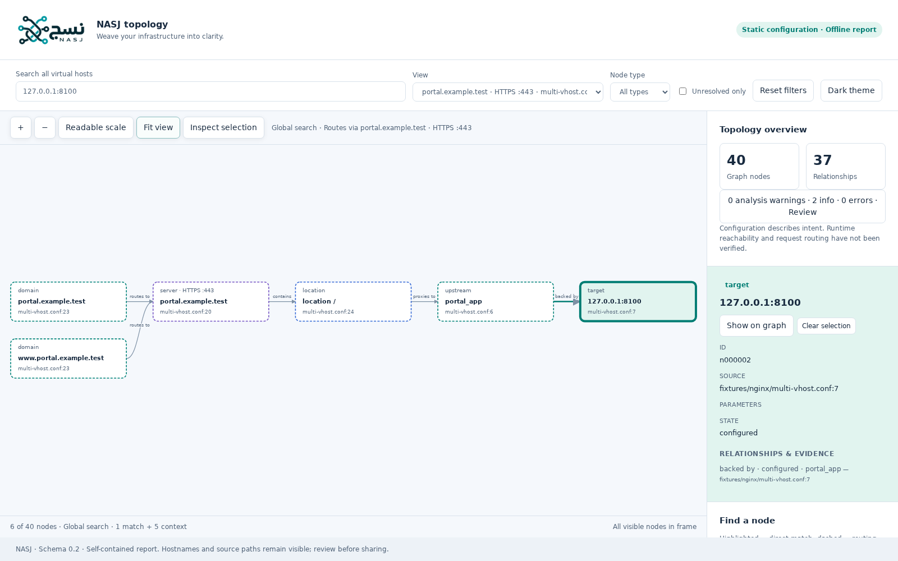

<p align="center">
  <picture>
    <source media="(prefers-color-scheme: dark)" srcset="assets/logos/display/logo_primary_dark.png">
    
  </picture>
</p>
<h1 align="center" dir="rtl">نسج — NASJ</h1>
<p align="center" dir="rtl"><strong>انسج بنيتك التحتية في صورة واضحة.</strong></p>
<p align="center" dir="rtl">حوّل إعدادات Nginx إلى خريطة تفاعلية للبنية التحتية، مع توثيق الملف ورقم السطر لكل علاقة.</p>
<p align="center">
  <a href="https://github.com/marawan6569/Nasj/actions/workflows/ci.yml"></a>
</p>
<p align="center" dir="rtl">Rust · ترخيص MIT · جرى التحقق على Linux · <a href="README.md">English</a></p>

<div dir="rtl">

> **نسخة تطوير غير منشورة.** التنفيذ بانتظار مراجعة
> [طلبات الدمج المتتابعة](docs/RELEASE_READINESS.md#review-and-merge-sequence).
> لم يصدر بعد إصدار مستقر، ولا تتوفر ملفات تنفيذية منشورة أو حزمة على crates.io.

قد تتوزع قواعد Nginx بين مضيفين افتراضيين ومسارات متداخلة وملفات تضمين متعددة.
يجمعها نسج في خريطة واحدة: تتبّع النطاق إلى الخادم ووجهة الوكيل العكسي، وافحص
مسارات الملفات والتحويلات الشرطية، ثم ارجع إلى مصدر كل علاقة في الإعدادات.
تظل المسارات التي تعجز الأداة عن حسمها مميزة بوضوح، دون افتراض وجهات غير مثبتة.

## الميزات المنفذة

- **أداة Rust لسطر الأوامر:** تحليل إعدادات Nginx ضمن حدود للموارد، مع التضمين المتكرر وأنماط الملفات.
- **خريطة للإعدادات المعلنة:** مضيفون افتراضيون يعملون عبر HTTP وHTTPS، وكتل المسارات، ومجموعات upstream وأعضاؤها، ووجهات الوكيل العكسي، وroot وalias، ومجموعة محددة من التحويلات الشرطية.
- **أربع صيغ للتصدير:** JSON ذي مخطط مرقّم، وGraphviz DOT، وSVG مستقل، وHTML تفاعلي.
- **تقرير HTML واحد يعمل دون إنترنت:** عرض مقروء للمضيف، وبحث يحتفظ بسياق العلاقات، وتصفية وتكبير وتحريك ولمس، ولوحة فحص، ومظهران فاتح وداكن.
- **مصادر وتشخيصات واضحة:** الملف ورقم السطر، ومستويات معلومات وتحذير وخطأ، وتمييز الإعدادات المعلنة عن بيانات العرض الاصطناعية.
- **قراءة فقط:** لا تعديل للإعدادات، ولا إعادة تحميل لـNginx، ولا رفع للصلاحيات، ولا قياس عن بُعد أو اكتشاف تلقائي عبر الشبكة.

## البدء السريع

ثبّت [أدوات Rust المستقرة](https://rustup.rs) وأداة الربط الخاصة بنظامك.
استخدم فرع المعاينة التراكمي ما دامت طلبات الدمج قيد المراجعة:

<div dir="ltr">

```sh
git clone --branch docs/official-branding https://github.com/marawan6569/Nasj.git
cd Nasj
cargo install --locked --path crates/nasj-cli
nasj --help
nasj map --config fixtures/nginx/multi-vhost.conf --strict --format html -o report.html
```

</div>

افتح `report.html` مباشرة في المتصفح. يستخدم المثال ملفات اختبار اصطناعية فقط،
ويصدر ملاحظتين معلوماتيتين لأنماط تضمين اختيارية لا تطابق أي ملفات.
تأكد من وجود مجلد أدوات Cargo في `PATH`. جرى التحقق على Linux x86_64 باستخدام
Rust 1.99.1؛ لم يُتحقق بعد من إصدارات Rust الأقدم أو الأنظمة الأخرى.
لا يحتاج التشغيل إلى Graphviz أو Python أو Node.js أو اتصال بالإنترنت أو Nginx يعمل فعليًا.

## استكشاف الإعدادات

<div dir="ltr">

```sh
nasj map --config ./nginx.conf --format json -o topology.json
nasj map --config ./nginx.conf --format dot -o topology.dot
nasj map --config ./nginx.conf --format svg -o topology.svg
nasj map --config ./nginx.conf --format html -o report.html
```

</div>

اختر مسارات إخراج جديدة؛ ترفض الأداة الكتابة فوق الملفات والروابط الرمزية الموجودة.
عند غياب `-o`، تُرسل الصيغة المختارة وحدها إلى المخرج القياسي. ينتج `nasj demo`
عرضًا اصطناعيًا منفصلًا. تُحصر ملفات التضمين افتراضيًا داخل مجلد أساس الإعدادات؛
يمكن تحديده عبر `--prefix`، والسماح بالتضمين خارجه صراحة عبر `--allow-external-includes`.
يسمح `--strict` بالملاحظات المعلوماتية ويرفض التحذيرات والأخطاء، وتوقف أخطاء
الإدخال المطلوبة التحليل دائمًا دون إنشاء خريطة جزئية.

في تقرير HTML، اختر مضيفًا أو ابحث عن نطاق أو وجهة خلفية أو مسار أو ملف مصدر.
تُبرز العقد المطابقة مباشرة، وتحتفظ العقد ذات الحدود المتقطعة بسياق العلاقات.
اختر عقدة لفحص خصائصها وأدلتها. تُظهر نتائج البحث المحدودة تنبيهًا عند احتمال
نقص السياق، وتبقى خيارات ملاءمة العرض والمقياس المقروء متاحة.

[](docs/images/report-preview.png)

*أُنشئت المعاينة من ملفات الاختبار في المستودع، مع توحيد مسارات المصادر للنشر.
لم تُستخدم إعدادات أو تقارير من بيئة إنتاج.*

## النطاق والأمان

يصف نسج **الإعدادات المعلنة**، ولا يؤكد أن الخدمات تعمل أو أن طلبًا فعليًا سيسلك
مسارًا معينًا. تبقى المتغيرات رمزية، وتبقى الشروط غير المدعومة وسلوك إعادة الكتابة
والمعالجات غير الخاصة بـHTTP غير محسومة. لا يحاكي نسج تنفيذ الطلبات بالكامل،
ولا يستبدل `nginx -t`. راجع [حدود التحليل المدعوم](docs/ANALYSIS.md).

تؤمّن التقارير ترميز المحتوى غير الموثوق وتحجب الحقول الحساسة المعروفة، لكن أسماء
المضيفين ومسارات الملفات تظل ظاهرة. لا يوجد ضمان لاكتشاف جميع الأسرار؛ راجع التقرير
قبل مشاركته. يحتوي HTML على جميع الموارد والشعارات المعتمدة محليًا، ويستخدم سياسة
أمان محتوى مقيدة دون طلبات خارجية. اقرأ [سياسة الأمان](SECURITY.md).

## التوثيق

| الدليل | المحتوى |
| --- | --- |
| [المعمارية](docs/ARCHITECTURE.md) | حدود النواة والمصدّرات وسطر الأوامر |
| [التحليل والصياغة](docs/ANALYSIS.md) | التضمين والتوجيه المدعوم وحدود اليقين |
| [مخطط JSON 0.2](docs/JSON_FORMAT.md) | البنية المرجعية والأدلة والتوافق |
| [التقارير](docs/REPORTS.md) | الصيغ والتفاعل والأمان واختبارات المتصفح |
| [ملفات الهوية الرسمية](assets/logos/README.md) | الأصول المعتمدة ونسخ العرض ومصدرها |
| [جاهزية الإصدار](docs/RELEASE_READINESS.md) و[قائمته](docs/RELEASE_CHECKLIST.md) | ترتيب المراجعة والقرارات المتبقية والتحقق |
| [المواصفات](docs/SPEC.md) و[خطة التنفيذ](docs/IMPLEMENTATION_PLAN.md) | المتطلبات وسجل التنفيذ |

## الخطة والمساهمة

تنفّذ معاينة **v0.1** التحليل الثابت والتقارير دون إنترنت، ولم تُدمج أو تُنشر بعد.
يُخطط في **v0.2** لربط اختياري بحاويات Docker وخدمات systemd والعمليات مع حفظ الأدلة،
وفي **v0.3** لخادم محلي اختياري. **الاكتشاف والخادم غير منفذين.** راجع [الخطة](docs/ROADMAP.md).

نرحب بتقارير الأخطاء وملفات الاختبار الاصطناعية وطلبات الدمج المحددة النطاق.
اقرأ [دليل المساهمة](CONTRIBUTING.md)، ولا تنشر إعدادات خاصة أو بيانات اعتماد أو
تقارير تشغيل في المسائل العامة. يعتمد المشرفون عمليات الدمج والإصدارات.
تُسجل التغييرات في [سجل التغييرات](CHANGELOG.md).

المشروع مرخص وفق [MIT](LICENSE)، وتتوفر تصريحات تراخيص الاعتماديات في
[الجرد](docs/DEPENDENCY_LICENSES.md). نسج مشروع مستقل ولا يتبع F5 أو NGINX.

</div>
